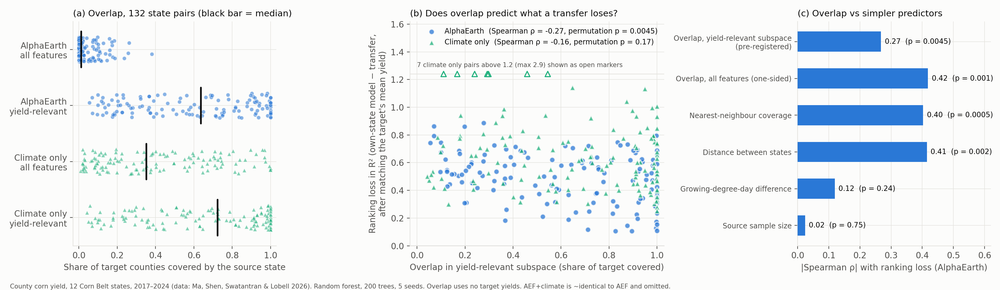
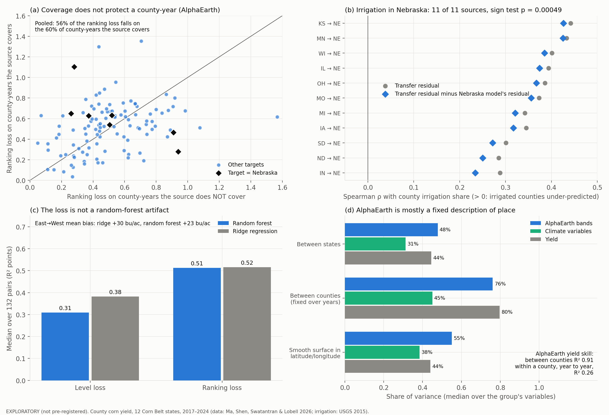

# Overlap and cross-region transfer of satellite crop-yield models

**A pre-registered test with AlphaEarth embeddings across 12 U.S. Corn Belt states**

Geospatial foundation-model embeddings such as AlphaEarth Foundations (AEF) match traditional
remote-sensing features for county corn-yield prediction when trained locally, but transfer much
worse across regions (Ma, Shen, Swatantran & Lobell, 2026). This repository asks whether that
failure can be anticipated without any yields from the target region. The measure is overlap: how
well the training region's data cover the target region in feature space, which is the positivity
condition of causal inference.

The analysis uses the authors' shared data: 6,325 county-years, 12 states, 2017–2024. It
reproduces their East↔West result, trains a model in every state and tests it in every other
(132 transfers), and evaluates predictions committed in a
[pre-registration](PREREGISTRATION.md) before any transfer loss was computed. Exploratory
follow-ups, designed after those results were known, then test three explanations they raised.
These are reported separately.



## Key findings

**Pre-registered (E1–E6).**

1. **In AlphaEarth space, every state is an island.** A cross-validated domain classifier
   separates the two states with AUC ≥ 0.99 for 130 of 132 ordered pairs. With climate
   covariates alone, it does so for 58 of 132.
2. **Most cross-state transfers fail.** The median AEF transfer R² is −0.02, and 68 of 132 are
   negative, against 0.74 for a model trained in the target state. About 43% of the loss is a
   shift in level that the target's mean yield would correct; the rest is lost ranking skill.
3. **Overlap measured without target yields predicts the ranking loss** (primary test: Spearman
   ρ = −0.27, QAP permutation p = 0.0045). It does so better than the difference in growing
   degree days between states (ρ = 0.12, p = 0.24).
4. **But it adds little beyond geography.** Distance between states predicts the ranking loss at
   least as well (ρ = 0.41, p = 0.002). The partial association controlling for distance, GDD
   difference and state fixed effects is not significant (p = 0.09).
5. **Climate inputs do not explain the Landsat baseline's advantage.** Adding the RS baseline's
   ten climate covariates to AEF leaves East↔West transfer unchanged (0.06 / 0.52 vs 0.07 /
   0.51).

**Exploratory (F1–F3, not pre-registered).**

6. **Coverage does not protect a county.** Within a transfer, county-years the source covers lose
   as much ranking skill as those it does not: pooled, 56% of the ranking loss falls on the 60% of
   county-years that are covered. Overlap tells you which *pairs* are risky, not *where* in the
   target the model fails.
7. **Irrigation explains failures overlap cannot see.** Within Nebraska, irrigated counties are
   under-predicted by models transferred from every one of the 11 other states. The median
   Spearman ρ between irrigation share and the transfer-specific error is 0.36 (11 of 11 positive,
   sign test p = 0.0005), against 0.16 for Nebraska's own model. Kansas shows the same pattern
   (ρ = 0.40, 10 of 11, p = 0.006). This is concept shift: the same imagery means a different yield
   under irrigation. Irrigation differences do **not** predict which state pairs lose most
   (ρ = −0.001).
8. **The loss is not a random-forest artifact.** Ridge regression, which can extrapolate, loses as
   much ranking skill (median 0.52 vs 0.51) and has a larger level bias (East→West +30 vs
   +23 bu/ac). Under ridge, overlap and distance again predict the loss about equally
   (ρ = −0.39 and 0.40).
9. **AlphaEarth is mostly a fixed description of place.**
   - **Fixed per county.** The median AEF band has 76% of its variance between counties, constant
     across years, against 45% for climate variables.
   - **Location.** 55% of the variance lies on a smooth surface in latitude and longitude.
   - **Skill.** AEF ranks counties' mean yields very well (R² 0.91), but year-to-year changes
     within a county only weakly (R² 0.26).

   A model trained in one state therefore learns mostly about that state's places, which is
   consistent with overlap tracking distance.



### East↔West reproduction (E1)

Mean of 5 seeds.

| Input | East→West R² | West→East R² | East→West R², target mean matched |
|---|---|---|---|
| AlphaEarth, random forest | 0.07 (paper: 0.02) | 0.51 (paper: 0.51) | 0.39 |
| AlphaEarth + climate, random forest | 0.06 | 0.52 | 0.38 |
| Climate only, random forest | −0.08 | −0.39 | 0.13 |
| AlphaEarth, ridge (F2, exploratory) | −0.16 | 0.21 | 0.37 |

### Pre-registered predictions (AlphaEarth arm)

| | Prediction | Result |
|---|---|---|
| **P2** (primary) | Yield-subspace overlap is negatively associated with ranking loss | **Supported.** ρ = −0.27, p = 0.0045 |
| P3 | The association survives distance, GDD difference and state fixed effects | **Not supported.** Partial coefficient −0.16, p = 0.09 |
| P4 | Overlap relates more to the ranking part of the loss than to the level part | **Supported.** abs(ρ) 0.27 vs 0.18 |
| P5 | Lower yield-range coverage explains which direction has the larger level loss | **Not supported.** 32 of 66 pairs |
| P1, P6 | AEF overlap is thinner than Landsat overlap, and the gap tracks the loss gap | **Not tested.** See [Landsat arm](#landsat-arm) |

All numbers, file by file, are listed in [results/README.md](results/README.md).

## Reproducing the results

Requires Python ≥ 3.9 and about 40 minutes on an 11-core laptop for everything.

```bash
make setup          # .venv with the pinned environment (requirements.txt) + this package
make data           # source tables, pinned versions, SHA-256 verified
make test           # unit tests on synthetic data with known answers
make preregistered  # E1 reproduction, E3 132-pair transfer matrix, E4 overlap   -> results/preregistered/
make evaluate       # E5/E6 pre-registered tests                                -> results/preregistered/
make exploratory    # F1-F3 exploratory follow-ups                              -> results/exploratory/
make figures        # fig1_preregistered.png, fig2_exploratory.png               -> results/figures/
```

All randomness is seeded. A full rerun from the final code matched every committed
pre-registered value to within 3 × 10⁻¹⁴, which is floating-point rounding from parallel
summation. Each results folder records its versions, hardware, data checksum and runtime in
`environment.txt`.

## Repository layout

Naming: `e1`–`e6` are pre-registered, `f1`–`f3` exploratory, `fig1` and `fig2` figures. Files are
lowercase snake_case.

```
├── PREREGISTRATION.md                 predictions, measures, tests; committed before any result (+ Amendment 1)
├── docs/methods.md                    full specification, deviations, exploratory methods, references
├── src/aeoverlap/
│   ├── data.py                        loading, input arms, study constants, irrigation data
│   ├── transfer.py                    random forest, oracle, loss decomposition
│   ├── overlap.py                     domain-classifier, subspace and kNN overlap; rival predictors
│   ├── inference.py                   QAP permutation and DSP partial tests for dyadic data
│   ├── run_preregistered.py           E1, E3, E4
│   ├── evaluate_preregistered.py      E5, E6
│   ├── run_exploratory.py             F1 concept shift and irrigation, F2 ridge, F3 geography
│   ├── figures.py                     fig1, fig2
│   └── rs_features.py                 Landsat harmonic coefficients -> phenology features
├── gee/                               Earth Engine export for the Landsat arm (gee/README.md)
├── tests/                             pytest suite on synthetic data, run in CI
├── scripts/get_data.sh                pinned, checksum-verified downloads
└── results/                           preregistered/, exploratory/, figures/ (results/README.md)
```

## Data

| Source | Contents | Use |
|---|---|---|
| Ma et al. (2026), [github.com/yuchima8/Harvest_AlphaEarth](https://github.com/yuchima8/Harvest_AlphaEarth), commit `2ec9163` | NASS county corn yields; AlphaEarth annual embeddings averaged over CDL corn pixels; monthly ERA5-Land GDD and precipitation; county boundaries | all analyses |
| USGS county water use 2015 (Dieter et al., 2018), [doi:10.5066/F7TB15V5](https://doi.org/10.5066/F7TB15V5) | irrigated acres per county | exploratory F1 only |

Neither table is redistributed here. The first has no license file upstream. `make data`
downloads both and verifies their checksums.

## Methods in brief

- **Loss decomposition.** Each transfer's loss, relative to a model trained in the target state,
  is split into a level part, removable by matching the target's mean yield, and a ranking part.
- **Overlap.** Coverage is the share of target county-years that the source covers. It is
  estimated with cross-fitted, class-balanced domain classifiers that never see target yields,
  using folds that hold out whole counties.
- **Primary measure.** Coverage in a three-component PLS subspace of yield-relevant directions,
  fitted on the source state. Overlap in all 64 dimensions is saturated, consistent with D'Amour
  et al. (2021).
- **Inference.** The 132 pairs share states, so inference uses QAP permutation of state labels
  and double-semi-partialling for partial effects.

Full details, including the exploratory definitions, are in [docs/methods.md](docs/methods.md).

## Landsat arm

The comparison that could separate overlap from geography is the Landsat (RS) arm. If Landsat
features overlap across distant but agronomically similar states, the two come apart there.

The arm is implemented in [`gee/`](gee/README.md) and passed a one-county check on Earth Engine.
A single-year, 12-state export, however, consumed compute at roughly 25 EECU-hours per minute, so
the eight-year export does not fit the free noncommercial tier. P1 and P6 are therefore untested.

## Limitations

- **Small effective sample.** Twelve states give 132 dependent pairs. QAP accounts for the
  dependence but leaves power modest.
- **Confounding with geography.** Overlap and distance are correlated (ρ = −0.35), so the design
  cannot separate their effects. F3 suggests why: AEF is largely a fixed description of place.
- **Irrigation measure.** USGS 2015 irrigated area covers all crops, not corn, and is fixed in
  time. The F1 irrigation results are exploratory and county-level only.
- **Choice of primary measure.** K = 3 for the PLS subspace was chosen after the probe showed
  full-space overlap to be saturated, and before any transfer loss was computed. This is disclosed
  in the pre-registration.
- **Scope.** One crop, county scale, the United States, and years shared between source and
  target.

## Citation

See [CITATION.cff](CITATION.cff). Please also cite the source data:

> Ma, Y., Shen, Y., Swatantran, A., Lobell, D.B. (2026). Harvesting AlphaEarth: Benchmarking the
> geospatial foundation model for agricultural downstream tasks. *International Journal of
> Applied Earth Observation and Geoinformation*, 105258.
> https://doi.org/10.1016/j.jag.2026.105258

## License

The code and derived results are under the MIT license; see [LICENSE](LICENSE). The source data
belong to their authors. This project is independent and is not affiliated with or endorsed by
the authors of the source study.
